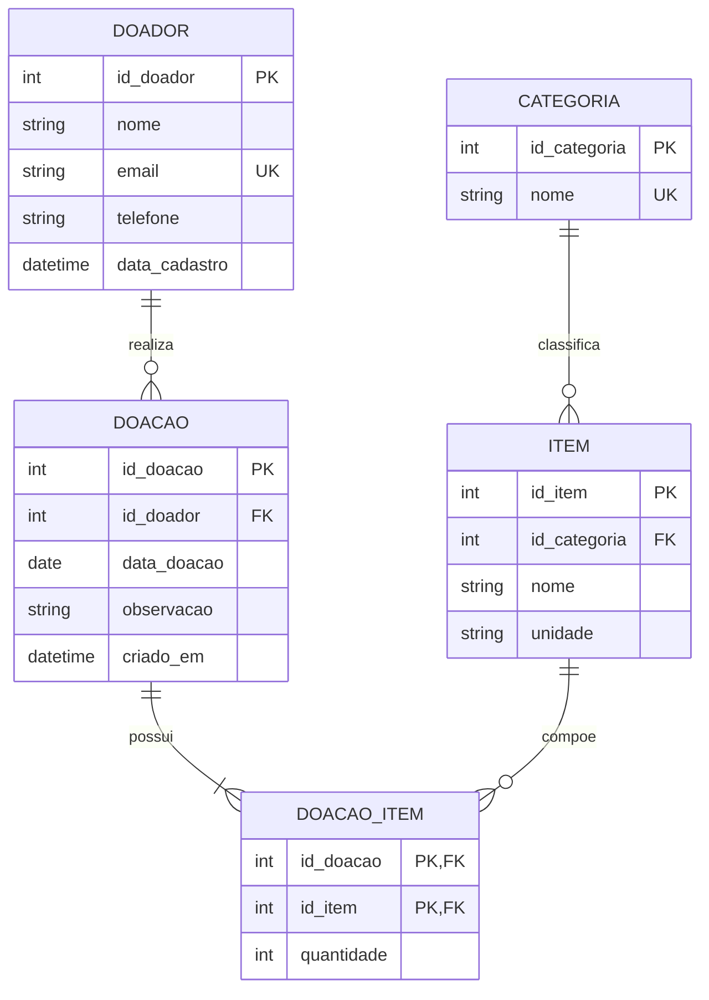

# Modelo entidade-relacionamento — Rede Semeia

Este documento registra o modelo de dados usado por `schema.sql` nesta entrega. O MER original do PIE I não foi recebido junto com os arquivos; por isso, este modelo foi reconstruído a partir do escopo da Rede Semeia e precisa ser comparado ao material do PIE I antes da entrega, caso haja diferenças.

## Relacionamentos e regras

- Um doador pode realizar nenhuma ou várias doações; cada doação pertence a um doador.
- Uma categoria pode classificar nenhum ou vários itens; cada item pertence a uma categoria.
- Doações e itens formam um relacionamento N:N, resolvido por `doacao_item`, cuja chave primária composta também impede repetir o mesmo item na mesma doação.
- Cada doação precisa ter pelo menos um item. A API valida essa regra antes de gravar os dados; as linhas de itens são gravadas em uma transação.
- A quantidade de cada item deve ser um inteiro maior que zero.
- Excluir uma doação remove seus itens associados. Doadores com doações e itens ainda referenciados não podem ser excluídos.
- E-mail do doador é opcional, mas, quando informado, não pode se repetir. Telefone e observação também são opcionais.

O arquivo [`schema.sql`](./schema.sql) implementa as entidades, chaves, restrições e regras que o banco consegue garantir.

